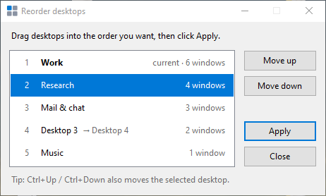

# DesktopOrder

Reorder Windows 10 virtual desktops with drag and drop.



Windows 10 has no built-in way to move a virtual desktop. DesktopOrder fakes it: it moves every window, and each desktop's name, into the desktop's new slot. If your current desktop moves, you go with it.

## Requirements

- Windows 10, version 1809 through 22H2. The tool uses Explorer's undocumented COM interfaces, which change between Windows builds. Windows 11 is not supported.
- .NET Framework 4.x, which ships with Windows. Nothing else needs installing.

## Download

Get `DesktopOrder.exe` from [Releases](https://github.com/abdullahkavakli/DesktopOrder/releases). No installation is needed. The exe isn't signed, so Windows SmartScreen may warn you the first time you run it.

## Build

To build it yourself instead, run:

```
build.cmd
```

This compiles `DesktopOrder.cs` with the `csc.exe` that ships with Windows and writes `DesktopOrder.exe` to your Desktop. To put it somewhere else, change `/out:` in `build.cmd`.

## Usage

Run `DesktopOrder.exe`. Drag the desktops into the order you want, or move the selected one with **Move up** / **Move down** or Ctrl+Up / Ctrl+Down. Then click **Apply**.

Command-line options, for troubleshooting:

| Command | What it does |
|---|---|
| `DesktopOrder.exe --list` | Prints each desktop with its id and window count |
| `DesktopOrder.exe --list -v` | Also lists every window on every desktop |
| `DesktopOrder.exe --selftest` | Creates two temporary desktops, swaps them, checks the result, then removes them. Your real desktops are left alone. |

The exe is a GUI app, so pipe its output to see it, for example `DesktopOrder.exe --list | more`.

## Limitations

- Windows pinned to all desktops and the shell's own windows (Start, Search, Action Center) are left where they are.
- Some windows can't be moved, such as those owned by elevated processes. The status bar says how many failed; running DesktopOrder as administrator usually fixes that.
- Don't add or remove desktops while the window is open. If you do, Apply reloads the list and asks you to try again.

## Credits

The COM interface declarations, and the window-moving approach behind the swap, come from [MScholtes/VirtualDesktop](https://github.com/MScholtes/VirtualDesktop).

## License

MIT. See [LICENSE](LICENSE). The MScholtes/VirtualDesktop license notice is in [THIRD-PARTY-NOTICES.txt](THIRD-PARTY-NOTICES.txt).
